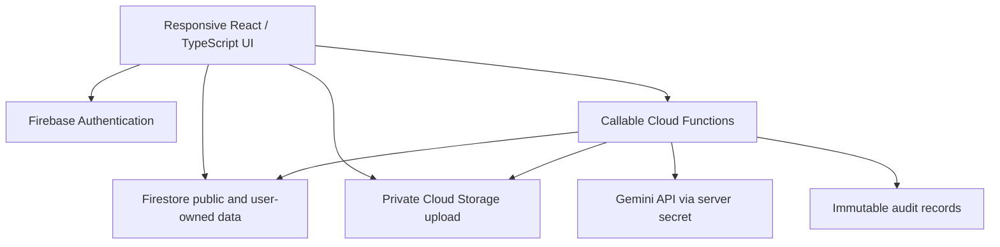
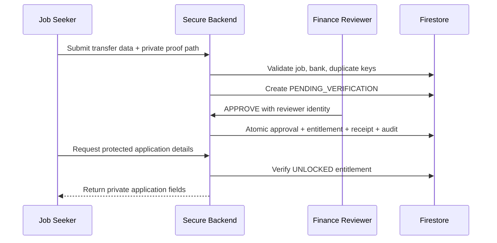

# Architecture

## Payment approval transaction

## Mobile application readiness

The browser application uses Firebase Auth and callable/backend APIs. Future Android and iOS applications can reuse the same identity, jobs, payments, job access, CV, AI and notification services without duplicating business rules.

## Trust boundaries

- Public job previews never include application URLs or private recruiter data.
- Storage proof objects are owner/staff restricted.
- Custom claims accelerate role checks; Firestore retains auditable role state.
- Payment and job approval happen only in privileged server functions.
- AI receives only verified active job records and explicit candidate content.
- Bank accounts, prices, categories and legal pages are database-configured.
